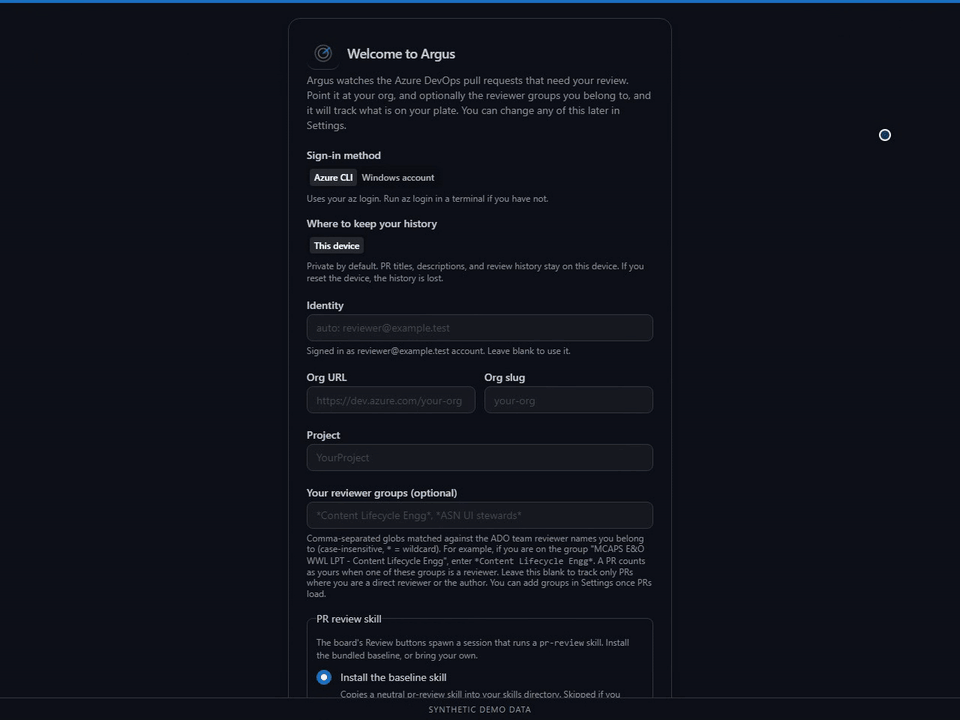

# Argus

Stop checking the same pull requests to work out which ones still need you.
Argus puts your Azure DevOps review queue in one place, separates work that
needs your attention from reviews a teammate has covered, and shows how your
review load changes over time.

Argus runs locally as a canvas extension in the GitHub Copilot app.

## Quick start

You need Windows x64, the Copilot app with canvas extensions enabled, Node.js
22.13 or later, and access to an Azure DevOps organization and project.

1. Sign in with the Azure CLI: `az login`. An experimental
   [Windows account sign-in option](docs/USER-GUIDE.md#sign-in-method) is also available.
2. [Install the Copilot plugin](docs/INSTALL.md#install-the-plugin).
   The [release ZIP](https://github.com/WretchedDade/argus/releases/latest)
   remains available as a fallback. Neither path needs a source build.
3. Reload extensions in Copilot, then open the **Argus** canvas.
4. Enter your organization URL, organization slug, and project. Add reviewer
   groups if you want to track team reviews, then select **Start watching**.

Setup starts the first poll immediately. The empty board shows loading feedback
until the poll finishes. Keep the canvas open for background polling.
Argus stores PR data and review history on your device by default.
[Setup and storage details](docs/USER-GUIDE.md#first-run) explain the options.

## Extension or review skill?

The **extension** provides the board, My PRs, Insights, and review history.
It works without a review skill.

The optional **`pr-review` skill** tells Copilot how to conduct a review and
record its verdict in Argus. The plugin includes the skill. ZIP setup can install
it, keep an existing one, or use your own. The three review actions need a review skill
and the Copilot app. [Review modes and skill setup](docs/USER-GUIDE.md#review-workflow-optional).

## Guides

- [Install, upgrade, and uninstall](docs/INSTALL.md)
- [Setup, sign-in, and configuration](docs/USER-GUIDE.md)
- [Build from source and run a browser preview](CONTRIBUTING.md)
- [Architecture](docs/ARCHITECTURE.md)

Contributions are limited to maintainers and explicitly invited contributors.
Public issues are not invitations to submit a pull request.
See [CONTRIBUTING.md](CONTRIBUTING.md).
