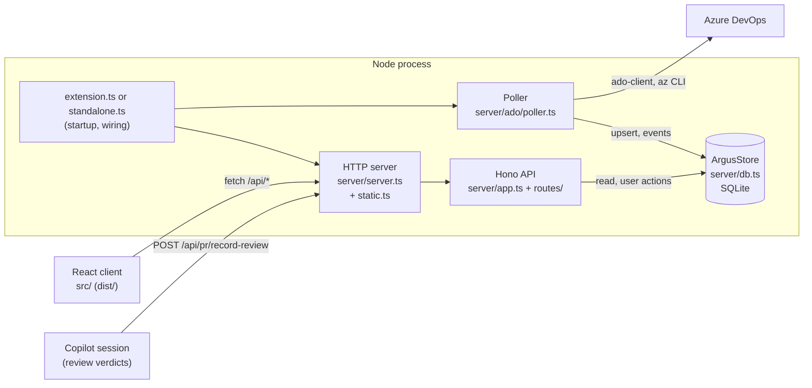

# Argus architecture

This document shows how the parts of Argus connect and where the data lives.

## Overview

Argus is one Node process with three jobs:

- A **poller** reads pull requests (PRs) from Azure DevOps (ADO).
- A **store** keeps them in a SQLite database.
- An **HTTP server** serves a React client and a JSON API.

Two entry points start the same parts:

| Entry point            | Used for                          | Database default                                  |
| ---------------------- | --------------------------------- | ------------------------------------------------- |
| `server/extension.ts`  | The Copilot app (canvas)          | See [Where the data lives](#where-the-data-lives) |
| `server/standalone.ts` | A normal browser, to try a branch | `data/standalone.db` in the repo                  |

## Startup

`extension.ts` runs these steps when the Copilot app loads it:

1. Resolve the database file (`server/storage.ts`) and copy the old file if the user changed the location.
2. Open `ArgusStore`. The constructor runs the pending migrations.
3. Build `getConfig()`. It merges the defaults, `argus.config.json`, and the overrides saved in the store.
4. Build a `PollerContext` (`{ store, getConfig }`). The poller does not start yet.
5. Register the canvas. Each open canvas instance starts its own HTTP server on a stable loopback port. All instances share the one store and poller. The **first canvas to open** starts the poller. When the **last canvas closes**, the poller stops. A host with no open canvas does not poll ADO.
6. Start the **ingest server** on a fixed port. Exactly one host owns it (the first to bind). It lets a review session record a verdict with plain HTTP.

`standalone.ts` does the same, but it starts the poller at startup. It runs without the Copilot app. Features that need a Copilot session (Review, re-review, archive) fail with a clear message.

## Poller

`server/ado/poller.ts` runs on a clock-aligned schedule during work hours (`scheduleNext`). Each run:

- reads PRs from ADO through `packages/ado-client` and the `az` CLI helpers in `server/ado/`;
- normalizes them (`normalize.ts`);
- reconciles the result with the store (`reconcile.ts`), which writes `prs` rows and appends `pr_events`;
- records the run in `poll_runs`.

Each tick catches its own errors, so one failed run does not stop the schedule. Every ADO call has a timeout (30 s for REST, 60 s for `az`). `withRetry` in `packages/ado-client/src/retry.ts` retries timeouts, network errors, 408, 429, and 5xx with backoff, and it honors `Retry-After`. It does not retry auth errors. A hung call therefore ends, and the run finishes. Several hosts can share one database, but only the host that holds the `poll_lease` row polls. It renews the lease while its poller runs, and another host takes over after the lease expires. A host without the lease skips its runs, and a manual refresh on it returns no summary. The poller does not change user choices such as lane, scope, or manual dismissal. It can clear a snooze: the store clears an expired snooze, and an FTE approval wakes an "until FTE approves" snooze. After each run it also applies the archive rules (see "Archive and scope").

Reconciliation refreshes metadata for every tracked PR that is not manually dismissed, even when its commit, draft state, and votes do not change. A metadata-only refresh does not add events, reset `updated_at`, or revive a stale archive.

If a poll response has no head SHA, reconciliation keeps the known SHA and commit time. A branch change clears the cached file count so the poller can read it again.

For authored PRs, policy and comment fetches report success separately. A failed fetch keeps the stored fields and records a warning in the poll trace. `authorMeta.lastSuccessfulAt` holds the last successful fetch time for policies and comments. Each time is `null` until that source succeeds. Older records can omit these times. No database migration is needed.

## Store

`ArgusStore` in `server/db.ts` uses `node:sqlite` in WAL mode. It keeps the database handle and delegates each method to a module in `server/store/`. Each module exports functions that take the handle: `settings.ts`, `activity.ts`, `events.ts`, and `prs.ts`. The insights and load analytics still live in `db.ts`. Add new queries to the matching module, and add a thin method to `ArgusStore`. There are two data models:

- `prs` holds the **current snapshot** of each PR.
- `pr_events` is the **append-only timeline**. Most metrics are derived from it.

Some metrics also read `prs` snapshot columns. For example, review latency uses `prs.reviewed_at` and `prs.reviewed_sha_authored_at`, and the backlog and authored-PR summaries use snapshot rows.

Other tables: `poll_runs`, `activity_log`, `settings` (key/value, holds the saved config overrides), `changes_read`, `repo_scopes`, and `poll_lease`.

User-managed columns live on `prs`. Only the dedicated action methods write them. `upsertPr` never does.

The schema lives in `server/store/migrations.ts` as an ordered list of migrations. `PRAGMA user_version` stores how many have run. At startup, `runMigrations` runs the pending ones in one `BEGIN IMMEDIATE` transaction, so two processes cannot race and a failure changes nothing.

## Archive and scope

Argus archives a PR to keep the board clean. An archive reuses the `dismissed`, `dismissed_reason`, and `dismissed_at` columns on `prs`. The reason is `stale` or `out_of_scope`. Any other reason is a manual dismissal, and Argus never revives it. Archive and revive each append an `archived` or `revived` event to `pr_events`.

- **Archived PRs stay polled.** When a stale PR changes, `reconcile.ts` marks the plan item `revive`, and `applyPlan` clears the archive and the old review session link.
- **Repo scope policy.** The `repo_scopes` table holds an `in` or `out` default for each repo. `prs.scope_override` holds a per-PR choice, and it wins over the repo default. `applyScopePolicy` computes the effective `out_of_scope` flag, archives the PRs that are out, and revives the `out_of_scope` archives that are now in. A PR in an `out` repo stays visible when you are its author or a named reviewer (`resolveOutOfScope`). A team-group match does not keep it visible.
- **Stale sweep.** `archiveStale` archives PRs with no activity for `STALE_ARCHIVE_DAYS` (30). It skips snoozed PRs and PRs with a review session in progress. The first sweep needs approval: `/api/archive/preview` lists the candidates, and `/api/archive/sweep` archives them and saves `stale_sweep_approved` in `settings`. After that, the poller sweeps each run.
- **Restore.** `restorePr` clears an archive by hand. It sets an `in` override when the PR was out of scope, so the policy does not archive it again.

Queries that count or list the board must exclude archived PRs. The audited queries are `countTracked`, `prsNeedingFileCount`, `listUnreadChanges`, `getArchivable`, the weekly-arrived query, the load counts, and the insights history filters. Insights history uses `manuallyDismissed`, so it still includes archived PRs.

## API

`server/app.ts` builds the Hono app. Routes live in `server/routes/`, one file per domain. The mounts in `server/app.ts` list the domains. Review and archive prompt builders live in `server/prompts.ts`.

`server/server.ts` creates one Hono request handler per HTTP server. Hono routes all requests. Both servers mount the same API. The canvas server also mounts the static routes in `server/static.ts`. These routes use `@hono/node-server/serve-static` for file paths, content types, and streaming. An unknown non-API `GET` path falls back to `index.html` for client routing. The ingest server does not serve static files. The bare `/api` path remains a client route on the canvas server.

Hono checks trusted API requests and returns JSON for unknown API paths. `server/validation.ts` uses Zod validators for request bodies and query parameters. The compatibility middleware treats empty action bodies as `{}` and reads the first value of a repeated query parameter. Invalid inputs return 400 before an action runs. Unexpected application errors are logged and return 500 with `{ "error": "Internal server error." }`. Domain routes can keep specific error responses, such as sign-in failures. The Node adapter handles transport errors. `server/api.ts` defines the shared `ApiContext` types.

API rules:

- Reads use `GET`. Actions that change data use `POST`.
- JSON responses use `c.json`. The image proxy returns bytes with its content type and cache headers.
- The client uses `hc<AppType>` from `hono/client`. Keep schema checks for shared response types.
- The API reaches the host through `ApiContext` (store, `getConfig`, poller functions). The auth and config routes call `resetIdentity` after a sign-in provider change.

`POST /api/pr/review` requires an explicit `mode`: `with-me`, `for-me`, or
`delegate`. The stored lane records the last interactive mode; it does not
select the next review mode. Only starting an interactive review changes it.

`POST /api/pr/record-review` accepts `provisional: true` only with verdict
`waiting`. It appends a `review_provisional` event for Delegate findings without
changing the review snapshot or completed-review metrics.

## Client

The client is a single-page app in `src/`:

- `src/main.tsx` creates the TanStack Router and the TanStack Query client.
- `src/routes/` holds one file per route. Vite generates `src/routeTree.gen.ts` from it. Do not edit or commit that file.
- `src/lib/api.ts` holds the response types, the `api` fetch helpers, and the `queryOptions` for each endpoint.
- API domain calls use `hono/client` with `AppType` from the server.
- `src/components/` holds shared components. Charts are in `Charts.tsx`.

There is no dev server. `npm run dev` runs a watch build, and you reload the canvas to see client changes. A server change needs a reload of extensions (or a restart of the Copilot app).

## Where the data lives

| Data                | Location                                                                                                                 |
| ------------------- | ------------------------------------------------------------------------------------------------------------------------ |
| Database            | Chosen in this order: `ARGUS_DB_FILE`, the saved choice, an older existing file, then `%LOCALAPPDATA%\argus\argus.db`    |
| Storage choice      | `%LOCALAPPDATA%\argus\storage.json` (beside the local database, because Argus must read it before it opens the database) |
| Local config        | `argus.config.json` in the extension folder, or the file in `ARGUS_CONFIG_FILE`                                          |
| Saved settings      | The `settings` table in the database. They override `argus.config.json`.                                                 |
| Standalone database | `data/standalone.db` (ignored by Git)                                                                                    |

The logic is in `server/storage.ts` and `server/config.ts`. See the README section "Where the database lives" for the user view.

## More guides

For conventions, see [patterns](patterns/README.md). For task steps, see [how-to](how-to/README.md).
